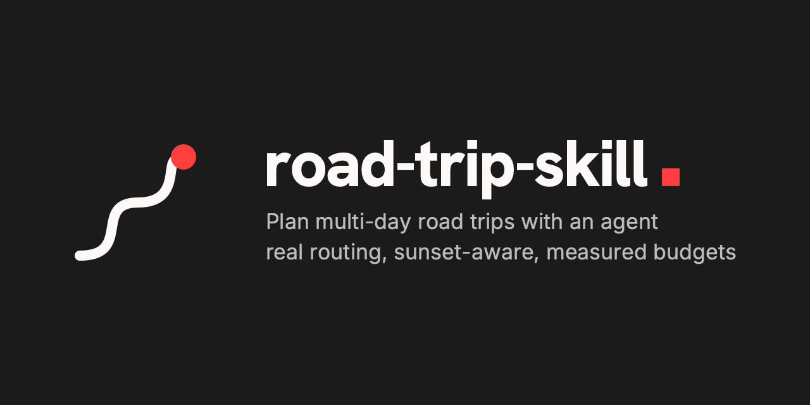

<p align="center"></p>

An [agent skill](https://agentskills.io/) for planning multi-day driving trips:
real routing, departure times that work backwards from a fixed appointment,
sunset-aware arrivals, offline per-day maps, and budgets calibrated against
what a trip actually costs. It runs in
[Claude Code](https://claude.com/claude-code), the Claude apps, and
[OpenAI Codex](https://developers.openai.com/codex) — one copy, no forks.

It is distilled from a real 12-day, 2,050 km trip across northern Spain
(Galicia → Asturias → Cantabria → León), planned and then continuously
reconciled against reality as it happened. **Every number in it is measured,
not guessed** — including the ones that show the original estimates were
wrong. And because they are measured, they are one trip's numbers: the skill
keeps **method** (universal, plain prose) and **calibration** (tagged
`⟨cal · N Spain, Aug 2026⟩` quotes) visibly apart, and teaches you to derive
your own calibration — most of it before you leave home, the rest on day 1.

## Install

```sh
# Claude Code
git clone https://github.com/danielperez9430/road-trip-skill \
  ~/.claude/skills/road-trip

# Codex — user-wide
git clone https://github.com/danielperez9430/road-trip-skill \
  ~/.agents/skills/road-trip
```

Either one is picked up on the next session. Ask for it by name (`/road-trip`,
`$road-trip`) or just describe the task — planning a route, estimating fuel,
working out what time to leave — and it loads on its own.

Codex also reads `<repo>/.agents/skills/` for a skill scoped to one project,
and `~/.codex/skills/` where its own installer puts things. All three follow
symlinks, so if you already have the skill for Claude Code you do not need a
second copy:

```sh
ln -s ~/.claude/skills/road-trip ~/.agents/skills/road-trip
```

*(Verified against Codex CLI 0.153.4: the skill is discovered through the
symlink and reported at its real path.)*

It works in the chat apps too: upload the folder as a skill on claude.ai and it
syncs back down into Claude Code. The skill knows which environment it is in
and degrades accordingly — with a shell it routes for real against a local
OSRM; without one it falls back to estimates and says so instead of pretending.
Routed distances live in a plain `legs.json`, so you can route once where you
have Docker and carry the file into any chat.

**One thing to set before you start in Codex:** its sandbox blocks outbound
network by default, which is exactly what geocoding needs. Enable it once —

```toml
# ~/.codex/config.toml
[sandbox_workspace_write]
network_access = true
```

— or approve the escalation when Codex asks. Building the OSRM graph is a
second gate: Docker's socket sits outside the sandbox, and for a 15-minute
build you may as well run `scripts/osrm-up.sh` yourself in a terminal and let
the agent talk to the server that comes out.

## What's inside

| File | |
|---|---|
| `SKILL.md` | The skill: pipeline, routing, geocoding, maps, timing, budget |
| `AGENTS.md` | Entry point for agents that read the repo instead of loading the skill |
| `reference/calibration.md` | Deriving your own numbers; the source trip's, tagged; what's unmeasured |
| `reference/osrm.md` | Self-hosting OSRM: build, serve, endpoints, sizing |
| `reference/geocoding.md` | Providers, picking the right hit, validation, caching |
| `reference/maps.md` | Projection, polyline simplification, navigation URLs |
| `reference/timing.md` | Anchored vs free days, NOAA sunset, timezones, seasons |
| `reference/budget.md` | Lodging billing models, fuel accounting, units, real figures |
| `scripts/osrm-up.sh` | Builds and serves a local OSRM for any Geofabrik regions and profile |
| `agents/openai.yaml` | Display name and one-liner for the Codex skill picker |

## A few things it will save you

**Geocoding is the error that matters, not routing.** Two independent routers
agreed to within 0.3% over 1,800 km. Geocoding was off by 2–4.5 km, because a
municipality's boundary centroid sits nowhere near its town centre. "León"
lands 34 km from the cathedral. A free LocationIQ token fixes most of it — the
skill offers to use one and works without it.

**Find the billing model before multiplying by nights.** Spanish campsites
bill per unit — adults + tent + car — so budgeting the listed 25 €/night came
in 24% low against a real 31.35 €. A typical North American campground bills
flat per site, so the same correction applied there would fabricate an
overrun. One real quote beats any national average.

**Real distance ≈ planned × 1.14.** Roughly 250 km of the trip were the
unplannable kind: back to the campsite, hunting for parking, wrong turns. That,
plus fuel costing more than estimated, put the fuel bill 21% over budget.

**Sunset comes out of NOAA in UTC.** The first version of this trip's code
hardcoded `TZ = 2` — right for Spain in summer, wrong at the first border and
the week the clocks change. Convert with an IANA timezone, per day. And at
Arctic latitudes the formula's `acos` goes out of domain: that is the
midnight sun, not a bug — the skill handles it instead of crashing.

**Waze cannot import a route.** Neither can the phone apps import GPX. A Google
Maps directions URL with `%7C`-joined waypoints is the only thing that will
navigate a whole multi-stop day, and it caps out at 9 intermediate stops.

**A straight line is not a road, and the error is not constant.** Across 65
real legs the road was 1.55× the great-circle distance at the median — but
1.22 at p10 and 2.36 at p90. Useful for sanity-checking a day; useless for
scheduling a timed entry. The skill shows how to derive *your* ratio from a
router and your own stops, without leaving your desk.

**Ramer–Douglas–Peucker must be iterative.** The recursive form overflows the
stack at 6,000 points — which is what one day of raw route geometry looks like.
Unsimplified, twelve day-maps weighed 743 KB; at a 0.4 px tolerance, 190 KB.

## Running the router

```sh
./scripts/osrm-up.sh europe/spain/galicia europe/spain/asturias
./scripts/osrm-up.sh north-america/us/arizona
PROFILE=bicycle ./scripts/osrm-up.sh europe/norway
```

Downloads the Geofabrik extracts, merges them with `osmium`, runs the OSRM MLD
pipeline with the chosen profile and serves on `127.0.0.1:5001`. Four Spanish
regions cost 1.7 GB of disk (~5× the extract size — budget with that), ~15
minutes to build, and 140 MB of RAM at rest.

Requires Docker. Nothing else.

## Scope

Calibrated in Spain; built to travel. The method — backward-resolved anchored
days, NOAA sunset in UTC, place nodes over boundary centroids, tank-to-tank
fuel accounting — holds in Norway in January or Arizona in July. Every
trip-specific constant is quarantined in a tagged `⟨cal⟩` quote, and
`reference/calibration.md` tells you how to measure your own replacement —
and says "unmeasured" where no honest number exists yet, instead of inventing
one.

## License

MIT — see [LICENSE](LICENSE).
